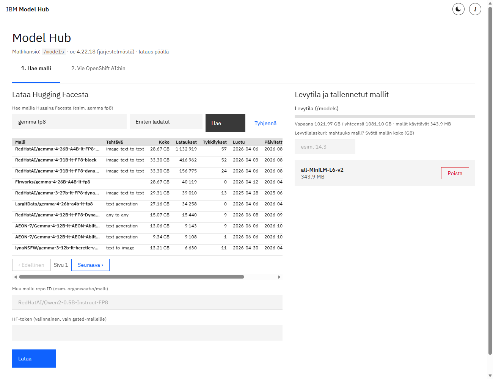
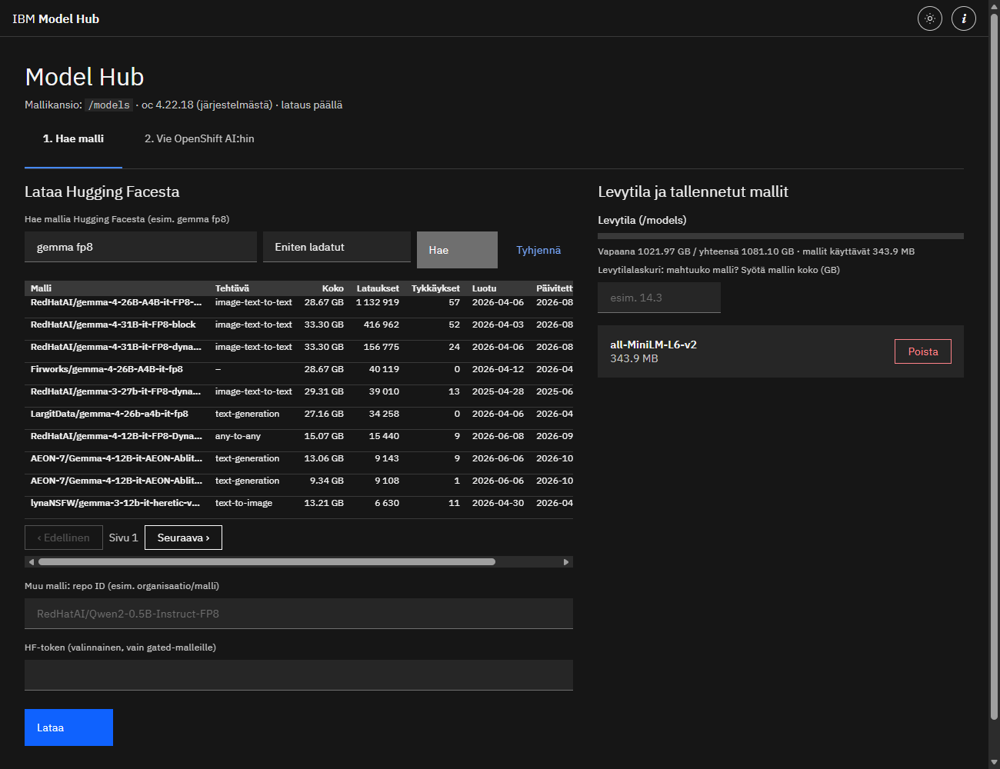
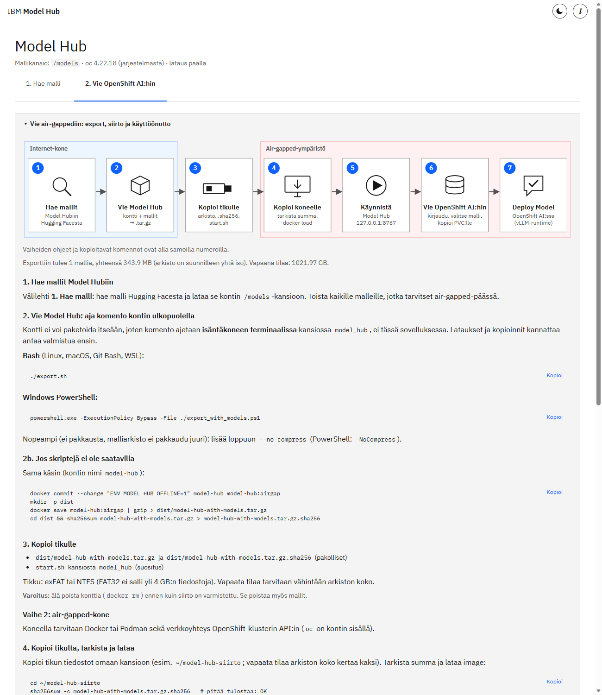
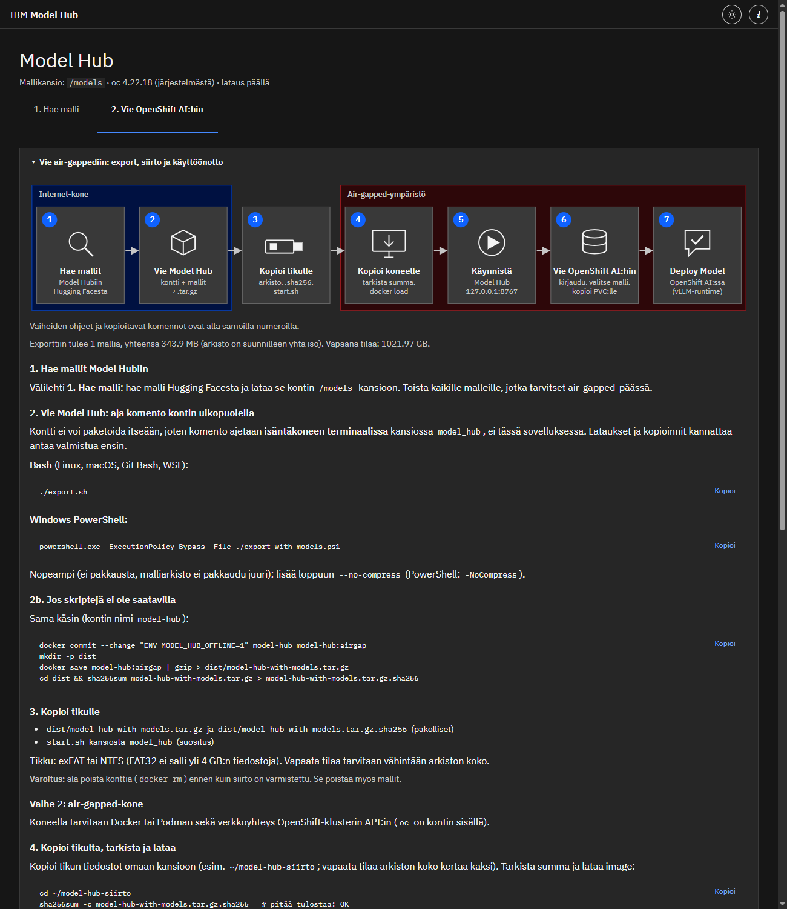

# Model Hub

> Asennusohje: [INSTALL.md](INSTALL.md)

Yksi sovellus: malli haetaan (tai tuodaan paketista) ja viedään OpenShift AI:n PVC:lle. Toimii yhdistettynä ja air-gapped-ympäristössä.

## Välilehdet
1. **Hae malli** – lataus Hugging Facesta (haku hakusanalla tai repo ID käsin; piilossa offline-tilassa).
2. **Vie OpenShift AI:hin** – `oc login`, projekti, PVC, loader-pod, kopiointi, tarkistus, siivous.

## Kuvakaappaukset

Vaalea ja tumma teema (vaihto ylärivin napista).

**1. Hae malli**



<details><summary>Tumma teema</summary>



</details>

**2. Vie OpenShift AI:hin: air-gapped-ohje vaihekaavioineen**



<details><summary>Tumma teema</summary>



</details>

UI on rakennettu IBM Carbon Design Systemillä (`static/carbon.css`, IBM Plex -fontit `static/fonts/`; ei ulkoisia riippuvuuksia, toimii offline). Edistymispalkeissa näkyy kulunut aika, nopeus ja arvio jäljellä olevasta ajasta; deploy-vaiheilla on omat kestonsa.

## Runtime-rakenne (OpenShift AI, KServe)

Lataus rakentaa mallikansion valmiiksi sen runtimen odottamaan muotoon. Polku OpenShift AI:ssa on `pvc://<pvc>/<malli>`.

- **Runtime**: `auto` (oletus) | `vllm` | `ovms`. `auto` lukee repon tiedostolistan ja `config.json`:n `architectures`-kentän ennen latausta ja näyttää päätelmän. `*ForCausalLM`/`*ForConditionalGeneration` + `*.safetensors` -> vLLM; `*.onnx` tai OpenVINO IR (`.xml` + `.bin`) -> OVMS; muuten virhe, jossa pyydetään valitsemaan runtime.
- **vLLM** (`<malli>/`, ei versiokansiota): vain `config.json`, `generation_config.json`, `tokenizer*`, `special_tokens_map.json`, `*.safetensors`, `*.safetensors.index.json`, `chat_template*`, `preprocessor_config.json`, `processor_config.json`. Ei `original/`, `onnx/`, `*.gguf`, `*.pth`, `pytorch_model*.bin`.
- **Embedding-mallit** (esim. BGE, E5, Qwen3-Embedding): jos repossa ei ole ONNX/OpenVINO-tiedostoja, `*Model`-arkkitehtuuri + safetensors valitaan vLLM:ksi. Mukaan tulevat myös tokenizer-tiedostot (`vocab.*`, `merges.txt`, `*.model`) ja sentence-transformers-tiedostot (`modules.json`, `sentence_bert_config.json`, `1_Pooling/config.json`). Valmis-ilmoitus muistuttaa vLLM-argumentista `--task=embed` (uudemmissa `--runner=pooling`); endpoint on `/v1/embeddings`. Jos repossa on ONNX, valitaan OVMS (tokenisointi on asiakkaan tehtävä).
- **OVMS** (`<malli>/<versio>/`): yksi variantti (oletus `onnx/model.onnx`) nimellä `model.onnx`, mahdollinen `*.onnx_data` samaan kansioon; OpenVINO IR nimillä `model.xml` + `model.bin`. `config.json` ja `preprocessor_config.json` mallikansion juureen. Versio on kokonaisluku; uusi siirto saman mallin päälle luo seuraavan vapaan numeron PVC:llä.
- **Turvallisuus**: lataus menee ensin väliaikaiseen kansioon (`.tmp-*`), lopulliseen polkuun siirretään vasta kun kaikki tiedostot ovat perillä. PVC:lle kopiointi tehdään samoin (`/mnt/models/.tmp-*` -> mv). Keskeytys ei jätä puolikasta mallia.
- **Tarkistukset**: repon koko (`model_info(files_metadata=True)`) vs. vapaa levytila ennen latausta ja vapaa tila PVC:llä ennen kopiointia.
- **Ylikirjoitus**: vLLM:llä olemassa oleva kansio vaatii vahvistuksen (`overwrite`, UI:ssa vahvistusikkuna / valintaruutu PVC-kopioinnissa).
- **Token**: kenttä UI:ssa, tai ympäristömuuttuja `HF_TOKEN` kontille.
- Huom: 10 GiB PVC ei riitä 8B-LLM:lle (fp16 ~16 GB). OVMS voi palvella OpenVINO-muunnettuja LLM:iä, mutta tarvitsee oman graph-konfiguraation, joten LLM:t ohjataan vLLM:ään.

## Model path ja jaettu PVC

- Model path OpenShift AI:n deploy-lomakkeessa on mallikansion nimi (repon nimi ilman organisaatiota), esim. `navy-ships-ONNX`; URI on `pvc://<pvc>/<malli>`. Sovellus näyttää arvon jo ennen kopiointia (mallivalinnan alla) ja kopioitavina kenttinä kopioinnin jälkeen. OVMS:llä ei anneta versiokansiota.
- Useita malleja samalle PVC:lle: jos PVC:tä käyttää jo pod (esim. mallipalvelin), deploymenttia ei tarvitse pysäyttää. ReadWriteOnce-PVC:n voi liittää useampaan podiin samalla nodella, joten apupodi ajetaan automaattisesti samalla nodella (`nodeName`). ReadWriteMany: ei rajoitusta. ReadWriteOncePod: jakaminen ei onnistu, käytä toista PVC:tä.

## Mallin testaus OpenShift AI:ssa

Välilehdellä 2 on lataus `osai_model_test.ipynb` (tiedosto: `static/osai_model_test.ipynb`, myös `/static/osai_model_test.ipynb`). Lataa se, tuo se OpenShift AI -projektin workbenchiin (JupyterLab → Upload), aseta osiossa 1 `ENDPOINT` ja `MODEL_NAME`, aja osio 2 (diagnostiikka) ja sen jälkeen mallityypin osio: 3 ONNX/OpenVINO (OVMS), 4 LLM (vLLM), 5 embedding. Täydellinen ohje on sovelluksen välilehdellä 2.

## Yhdistetty kone
```powershell
pip install -r requirements-online.txt
start.bat
```
Avaa http://127.0.0.1:8767

## Air-gapped-paketti
Yhdistetyllä koneella (sama OS/arkkitehtuuri ja Python-minor kuin kohteessa):
```powershell
.\build_airgap_bundle.ps1 -OcPath C:\oc\oc.exe
```
→ `dist\model_hub_airgap.zip` + `.sha256`. Siirrä zip kohdekoneelle, ja kohteessa:
```powershell
Expand-Archive model_hub_airgap.zip .
cd model_hub
.\install_offline.ps1
start.bat offline
```
Paketti sisältää: sovellus, Python-wheelit (`wheels/`), `tools/oc.exe`. `rsync` valinnainen (`-RsyncPath`); ilman sitä `oc rsync` käyttää tar-varmistusta.

Mallit tuodaan siirtomedialta kopioimalla mallikansio kansioon `models/`.

## Kontti (sisältää kaiken)
Mallit tallennetaan kontin sisään; kontti malleineen viedään air-gapped-ympäristöön image-arkistona. Täysi ohje: [KONTTI-OHJE.md](KONTTI-OHJE.md).
```powershell
# Vaihe 1 (internet): rakenna, käynnistä, lataa mallit UI:ssa, vie
docker build -t model-hub:latest .
docker run -d --name model-hub -p 127.0.0.1:8767:8767 model-hub:latest
.\export_with_models.ps1   # -> dist/model-hub-with-models.tar.gz + .sha256
# Vaihe 2 (air-gapped)
docker load -i model-hub-with-models.tar.gz
docker run -d --name model-hub -p 127.0.0.1:8767:8767 model-hub:airgap
```
Varoitus: `docker rm` ja `docker compose down` poistavat kontin ja mallit; pysäytä `docker stop`.

## Ympäristömuuttujat
| Muuttuja | Oletus |
|---|---|
| `MODEL_HUB_OFFLINE` | `0`; `start.bat offline` asettaa `1` |
| `MODEL_HUB_MODELS_DIR` | `models/` |
| `MODEL_HUB_LOADER_IMAGE` | `registry.access.redhat.com/ubi9/ubi:latest` |
| `OC_BIN` | `tools/oc.exe`, sitten PATH |
| `PORT` | `8767` |

## Rajoitteet
- `oc`-binäärin pitää vastata kohde-OS:ää (Linuxille tarvitaan Linux-`oc`, ei `.exe`).
- Loader-podin imagen (ubi9, sisältää `tar`) pitää olla klusterin omassa rekisterissä; aseta osoite `MODEL_HUB_LOADER_IMAGE`:lla (ohje: KONTTI-OHJE.md kohta 2.4).
- Sovellus kuuntelee vain 127.0.0.1:ssä, eikä siinä ole omaa autentikointia.


